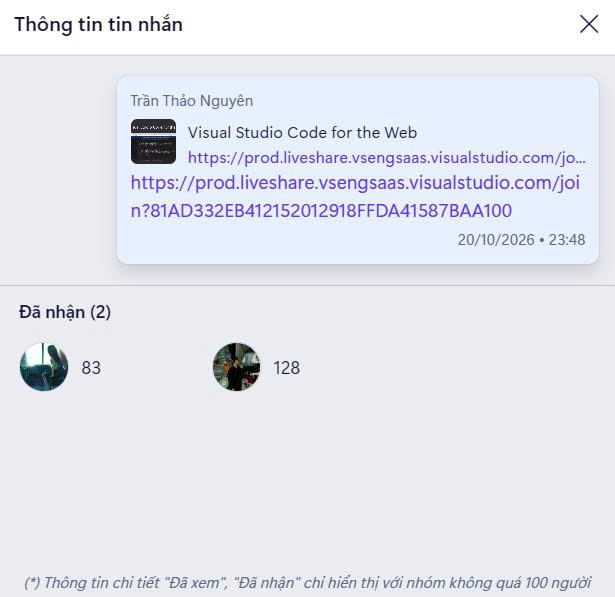
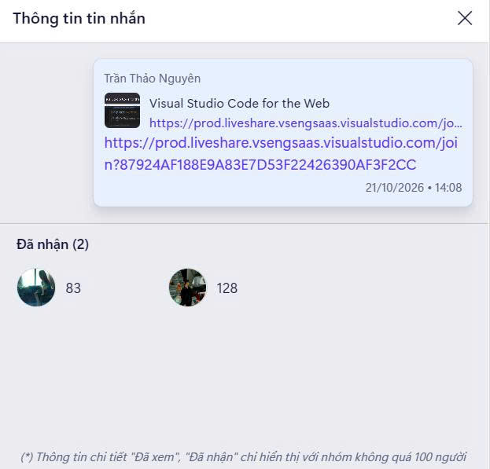
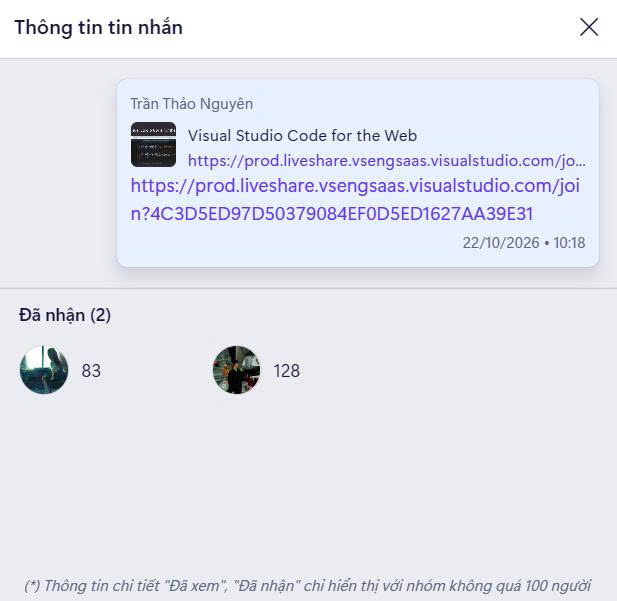
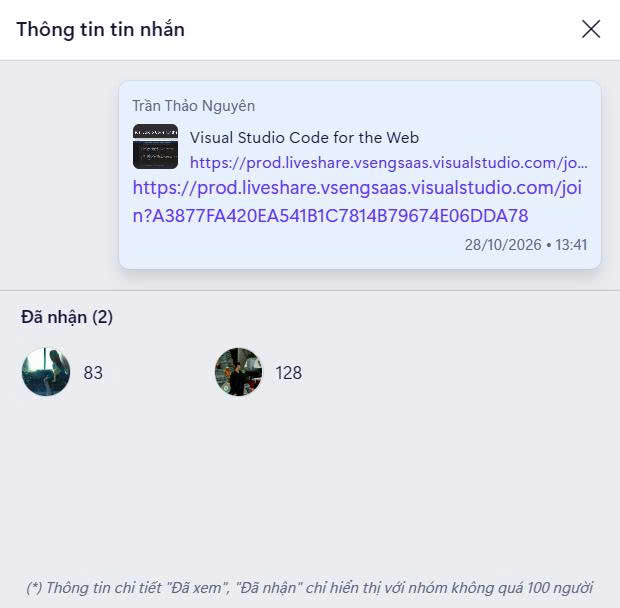
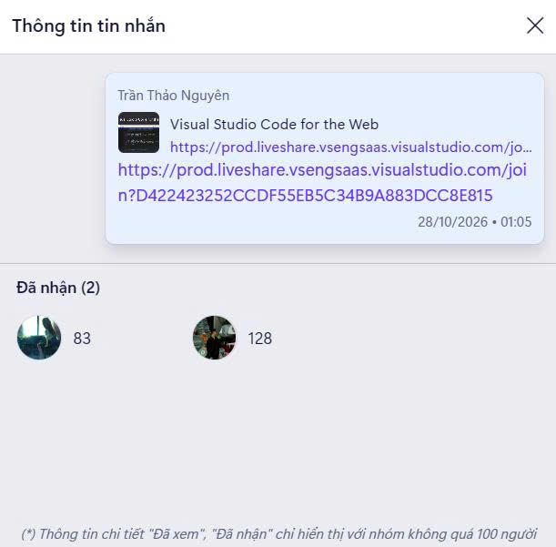

# NHẬT KÝ PHÁT TRIỂN DỰ ÁN – NYN06

**Môn học:** Công nghệ phần mềm (CNPM)  
**Dự án:** Hệ thống thuyết minh tự động theo vị trí GPS (Auto Narration)  
**GitHub:** [CNPM_Nhom4_DCT124C6](https://github.com/nyn06/CNPM_Nhom4_DCT124C6)  
**Tài khoản Git:** `nyn06`  
**Thời gian theo dõi:** 13/09/2026 – 25/11/2026

## 1. Mục đích

Tài liệu tổng hợp quá trình phát triển phần mềm theo từng tuần, dựa trên lịch sử commit của tài khoản `nyn06`.

Nội dung tập trung vào các chức năng đã triển khai, thay đổi kỹ thuật và quá trình tích hợp, kiểm thử hệ thống.

## 2. Báo cáo tiến độ theo tuần

| Tuần | Thời gian | Công việc thực hiện |
|---|---|---|
| 1 | 07–13/09/2026 | Khởi tạo Backend Node.js, xây dựng kiến trúc Controller – Service – Repository, cấu hình Docker, Jest và GitHub Actions. |
| 2 | 14–20/09/2026 | Không có commit. |
| 3 | 21–27/09/2026 | Không có commit. |
| 4 | 28/09–04/10/2026 | Tích hợp Piper TTS phục vụ tạo nội dung thuyết minh bằng giọng nói đa ngôn ngữ. |
| 5 | 05–11/10/2026 | Xây dựng POI, GPS geofence, WebApp demo; phát triển chức năng dịch đa ngôn ngữ, phát audio, tự động thuyết minh theo GPS và giao diện quản trị POI. |
| 6 | 12–18/10/2026 | Phát triển QR voucher, kích hoạt quyền tham quan và kiểm soát thời gian truy cập của du khách. |
| 7 | 19–25/10/2026 | Phát triển xác thực, phân quyền RBAC và giao diện Admin; tích hợp SQL Server, migration, kiểm thử tích hợp, bản đồ và geocoding. |
| 8 | 26/10–01/11/2026 | Hiển thị khoảng cách POI, sắp xếp các địa điểm gần nhất; phát triển giao diện Admin đa ngôn ngữ, Dashboard, quản lý voucher và cơ chế dịch POI. |
| 9 | 02–08/11/2026 | Không có commit. |
| 10 | 09–15/11/2026 | Điều chỉnh CI để kiểm thử SQL Server trên database riêng `AutoNarrationDBTest`; sao lưu trạng thái Git trước khi tích hợp. |
| 11 | 16–22/11/2026 | Tích hợp các nhánh chức năng, sửa kiểm thử Frontend sau merge, cập nhật Node.js cho CI, điều chỉnh bộ kiểm thử đa ngôn ngữ QR voucher; tích hợp DeepL để dịch mô tả POI, đồng bộ chức năng tải ảnh POI và các bản sửa lỗi đa ngôn ngữ trên Website và Admin. |
| 12 | 23–29/11/2026 | Tích hợp bản sửa lỗi tải ảnh POI từ thành viên, xử lý xung đột mã nguồn Admin; đồng bộ chức năng xác nhận tải ảnh, xóa ảnh POI, thông báo trạng thái đa ngôn ngữ và các bộ kiểm thử Frontend, API liên quan. |

## 3. Hình ảnh minh chứng quá trình phát triển

### 3.1. Tuần 7 – Xác thực, SQL Server và bản đồ (19–25/10/2026)

*Hình 1. Minh chứng công việc ngày 19/10/2026.*

*Hình 2. Minh chứng công việc ngày 20/10/2026.*

*Hình 3. Minh chứng công việc ngày 21/10/2026.*

*Hình 4. Minh chứng công việc ngày 22/10/2026.*

### 3.2. Tuần 8 – Giao diện quản trị và đa ngôn ngữ (26/10–01/11/2026)

*Hình 5. Minh chứng công việc ngày 28/10/2026.*

*Hình 6. Minh chứng công việc ngày 28/10/2026.*

*Hình 7. Minh chứng công việc ngày 28/10/2026.*

## 4. Các commit tiêu biểu

| Ngày | Commit | Nội dung |
|---|---|---|
| 13/09/2026 | [`95ea078`](https://github.com/nyn06/CNPM_Nhom4_DCT124C6/commit/95ea0786630edadb2c444e3100182924ae8d709a) | Khởi tạo Backend và CI/CD |
| 29/09/2026 | [`9dbf400`](https://github.com/nyn06/CNPM_Nhom4_DCT124C6/commit/9dbf400aaa2ed579c480a09326a8b2e895d26af1) | Tích hợp Piper TTS |
| 05/10/2026 | [`c1f0cda`](https://github.com/nyn06/CNPM_Nhom4_DCT124C6/commit/c1f0cdaca683d4dbd7054bccc15741e469041da3) | Xây dựng POI và GPS geofence |
| 06/10/2026 | [`ab2c2bf`](https://github.com/nyn06/CNPM_Nhom4_DCT124C6/commit/ab2c2bfede802af65eee20d546536b26ed789295) | Dịch nội dung POI đa ngôn ngữ |
| 07/10/2026 | [`2802530`](https://github.com/nyn06/CNPM_Nhom4_DCT124C6/commit/28025304c36bef0696acc6b918adea3509a6eeaa) | Tự động thuyết minh theo GPS |
| 08/10/2026 | [`2385317`](https://github.com/nyn06/CNPM_Nhom4_DCT124C6/commit/23853172e8e88829611934af1fff8fff26f66b29) | Xây dựng giao diện quản trị POI |
| 16/10/2026 | [`1af19dd`](https://github.com/nyn06/CNPM_Nhom4_DCT124C6/commit/1af19dd16e0c0711c3eabc2e09f9f228b7e4a697) | QR voucher và giới hạn thời gian truy cập |
| 19/10/2026 | [`62050db`](https://github.com/nyn06/CNPM_Nhom4_DCT124C6/commit/62050db0900a9680485166bceb3e3bb0f936fa17) | Xác thực và phân quyền RBAC |
| 20/10/2026 | [`c4e35a6`](https://github.com/nyn06/CNPM_Nhom4_DCT124C6/commit/c4e35a64e06e2ff7a32d71ae26a4aca9dc8290d8) | Tích hợp SQL Server và Integration Testing |
| 22/10/2026 | [`62f88e2`](https://github.com/nyn06/CNPM_Nhom4_DCT124C6/commit/62f88e246603c07482f99f409f0e99d7d594c32f) | Tích hợp bản đồ và geocoding |
| 29/10/2026 | [`482394f`](https://github.com/nyn06/CNPM_Nhom4_DCT124C6/commit/482394fd57cdf30c5ec50763f23054ba533e1b4a) | Giao diện Admin đa ngôn ngữ và migration |
| 11/11/2026 | [`61ddf50`](https://github.com/nyn06/CNPM_Nhom4_DCT124C6/commit/61ddf504a4cd100dc54d917c20945632b76206ab) | Cấu hình database kiểm thử riêng trong CI |
| 16/11/2026 | [`7cd2844`](https://github.com/nyn06/CNPM_Nhom4_DCT124C6/commit/7cd284491502d04b76111b741abfce3d9175c9f7) | Sửa cấu hình Node.js cho thư viện Sharp |
| 18/11/2026 | [`50042fd`](https://github.com/nyn06/CNPM_Nhom4_DCT124C6/commit/50042fde40097bfc965072bf80151e2dbb5333da) | Điều chỉnh kiểm thử đa ngôn ngữ QR voucher |
| 19/11/2026 | [`2aa3330`](https://github.com/nyn06/CNPM_Nhom4_DCT124C6/commit/2aa3330) | Tích hợp DeepL và cải thiện hiển thị bản dịch mô tả POI |
| 19/11/2026 | [`b88daf0`](https://github.com/nyn06/CNPM_Nhom4_DCT124C6/commit/b88daf0) | Tích hợp nhánh dịch mô tả POI bằng DeepL |
| 19/11/2026 | [`b84a8bb`](https://github.com/nyn06/CNPM_Nhom4_DCT124C6/commit/b84a8bb) | Tích hợp chức năng tải ảnh POI |
| 19/11/2026 | [`9a8b647`](https://github.com/nyn06/CNPM_Nhom4_DCT124C6/commit/9a8b647) | Tích hợp bản sửa lỗi đa ngôn ngữ Website |
| 19/11/2026 | [`ef508be`](https://github.com/nyn06/CNPM_Nhom4_DCT124C6/commit/ef508be) | Tích hợp bản sửa lỗi QR và đa ngôn ngữ quản lý tài khoản Admin |
| 25/11/2026 | [`6e24d81`](https://github.com/nyn06/CNPM_Nhom4_DCT124C6/commit/6e24d81) | Tích hợp bản sửa lỗi tải ảnh POI, xử lý xung đột Admin và đồng bộ bộ kiểm thử liên quan |

## 5. Ghi chú về lịch sử phát triển

- Chỉ thống kê các commit có tác giả là `nyn06`.
- Các commit merge được xem là hoạt động tích hợp mã nguồn, không tự động tính chức năng của thành viên khác thành đóng góp cá nhân.
- Các tuần không có commit không đồng nghĩa với việc không thực hiện công việc.
- Thời gian được xác định từ lịch sử Git, có thể khác thời điểm thực tế viết code.
- Có thể nhấn trực tiếp vào mã commit để xem các file và dòng code thay đổi trên GitHub.

## 6. Kết luận

Lịch sử commit phản ánh quá trình phát triển dự án từ khởi tạo Backend, xây dựng chức năng GPS và thuyết minh đa ngôn ngữ đến triển khai giao diện quản trị, tích hợp cơ sở dữ liệu SQL Server và thiết lập CI/CD.

Trong giai đoạn hoàn thiện, các công việc tập trung vào tích hợp dịch vụ DeepL, đồng bộ chức năng tải và xóa ảnh POI, hoàn thiện đa ngôn ngữ, hợp nhất các nhánh chức năng và xử lý xung đột mã nguồn nhằm nâng cao tính ổn định của hệ thống.

Tài liệu được sử dụng làm minh chứng hỗ trợ theo dõi tiến độ, đánh giá đóng góp cá nhân và giải thích các thay đổi mã nguồn trong quá trình báo cáo đồ án.
