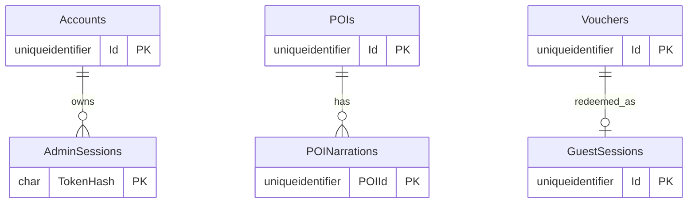

# Stage 10 — SQL Server và lưu trữ bền vững

## Mục tiêu và kết quả hiện tại

Stage 10 bổ sung SQL Server cho runtime thông thường, migration có version, Docker volume và integration test trên database riêng. Runtime chọn repository SQL; Jest unit test chọn adapter in-memory khi `NODE_ENV=test` và không đặt `DB_INTEGRATION=1`. Không có cơ chế tự động chuyển sang in-memory khi SQL Server lỗi. Controller → Service → Repository và các endpoint Stage 9 được giữ nguyên.

**Trạng thái xác minh:** Người dùng đã xác nhận SQL Server 2022 Docker healthy, SSMS kết nối được, migration `001_initial.sql` đã chạy trên `AutoNarrationDB` và backend khởi động thành công. Database integration test đã chạy trên `AutoNarrationTest`: 2/2 pass. Jest chạy 19/19 suites, 661/661 tests pass. CI mới đã được cấu hình nhưng chưa chạy trên GitHub.

## Kiến trúc và schema

`src/config/database.js` kiểm tra host, port, tên database, user, password và hai cờ TLS. `src/database/connection.js` giữ một connection pool `mssql` cho process; request dùng tham số. `database/migrate.js` tạo database nếu chưa có, ghi `dbo.SchemaMigrations` và chạy từng file SQL trong transaction. Startup chỉ nhận phiên bản migration `001_initial.sql`, sau đó bootstrap admin và bắt đầu nghe HTTP. Tín hiệu dừng đóng pool.

| Bảng | Mục đích và khóa chính |
| --- | --- |
| Accounts | UUID, username duy nhất, bcrypt hash, role, trạng thái khóa, version |
| AdminSessions | SHA-256 token hash, account FK, version, CSRF, hết hạn, thu hồi |
| LoginChallenges | SHA-256 challenge hash và CSRF trước login |
| POIs | UUID, tọa độ, geofence, metadata địa điểm |
| POINarrations | PK `(POIId, Language)`, text Unicode và tên WAV; cascade khi xóa POI |
| Narrations | Module `/api/narrations` cũ, độc lập với POI |
| Jobs | Module `/api/jobs` cũ |
| Vouchers | Code hash duy nhất, trạng thái và hạn sử dụng |
| GuestSessions | Token hash duy nhất, FK voucher duy nhất, thời gian truy cập |



`POINarrations.AudioFile`, `Narrations.AudioFile` và `Jobs.ResultAudioFile` chỉ lưu tên file. WAV vẫn nằm trong `public/audio`; SQL Server không lưu byte WAV. Không tạo bảng AudioFiles riêng vì mô hình hiện tại gắn tối đa một tên file với mỗi bản thuyết minh. Các trường văn bản dùng `NVARCHAR`, timestamp dùng `datetime2(3)` UTC. Migration có PK, FK, UNIQUE, CHECK và index cho tài khoản, session, POI, audio và voucher.

## Docker, `.env`, SSMS và PowerShell

Cài Docker Desktop với Linux containers/WSL2 trên máy x86-64. Microsoft hỗ trợ image `mcr.microsoft.com/mssql/server:2022-latest` và biến `MSSQL_SA_PASSWORD`; xem [hướng dẫn Microsoft](https://learn.microsoft.com/en-us/sql/linux/quickstart-install-connect-docker?view=sql-server-ver16) và [yêu cầu nền tảng](https://learn.microsoft.com/en-us/sql/linux/sql-server-linux-docker-container-deployment?view=sql-server-ver16). Compose riêng `compose.database.yml` không thay đổi LibreTranslate. Port chỉ bind localhost `14333:1433`, dữ liệu gắn named volume `sqlserver_data`. Healthcheck dùng `sqlcmd` trong image; kiểm tra `docker compose ps` để biết trạng thái thật.

Trong thư mục `be-demo`, sao chép `.env.example` thành `.env` nếu chưa có; nếu đã có, chỉ thêm các khóa DB. Đặt `DB_PASSWORD` mạnh, riêng cho máy, không commit. Các giá trị mẫu: `DB_HOST=localhost`, `DB_PORT=14333`, `DB_NAME=AutoNarrationDB`, `DB_USER=sa`, `DB_ENCRYPT=false`, `DB_TRUST_SERVER_CERTIFICATE=true` cho local self-signed certificate. Đặt `ADMIN_BOOTSTRAP_USERNAME`, `ADMIN_BOOTSTRAP_PASSWORD` (ít nhất 12 ký tự) và `ADMIN_ORIGIN=http://localhost:3000` như Stage 9. Production cần HTTPS và chứng chỉ SQL được tin cậy, không nên bật trust tùy tiện.

```powershell
Set-Location 'D:\SUBJECTS FOR IT\CNPM\be-demo-3layer-cicd\be-demo'
docker compose --env-file .env -f compose.database.yml up -d
docker compose --env-file .env -f compose.database.yml ps
docker compose --env-file .env -f compose.database.yml logs --tail 100 sqlserver
npm.cmd ci
npm.cmd run db:migrate
npm.cmd start
```

Để dừng mà giữ dữ liệu: `docker compose --env-file .env -f compose.database.yml down`. **Không thêm `-v`**, vì tùy chọn đó xóa volume. Khởi động lại bằng `up -d`. SSMS: Server `localhost,14333`; Authentication `SQL Server Authentication`; Login `sa`; password từ `.env`. Với certificate self-signed local, chọn Trust server certificate trong cửa sổ kết nối. Mở database `AutoNarrationDB` và kiểm tra `dbo.SchemaMigrations` sau migration. `database/create-database.sql` là script SSMS cho tên database mặc định; sau khi chạy nó, có thể mở `database/migrations/001_initial.sql` để xem/chạy schema lần đầu. Cách được khuyến nghị để chạy lại an toàn là `npm.cmd run db:migrate`, vì runner kiểm tra version trước khi áp dụng.

## Kiểm tra persistence và bảo mật

Sau khi SQL và migration thật sự hoạt động: đăng nhập ADMIN, tạo POI và lưu VI/EN/JA/KO, tạo voucher; dừng và chạy lại `npm.cmd start`; kiểm tra tài khoản, POI, bản thuyết minh và voucher còn trong API/SSMS. Redeem một voucher hai lần: lần đầu thành công, lần hai HTTP 409. Hai redeem đồng thời dùng transaction `SERIALIZABLE`, khóa hàng voucher và update có điều kiện. Admin session có hash, version, hạn 60 phút; đổi role/khóa/reset password tăng version và thu hồi session trong transaction. Guest session lưu hash và hạn, audio public vẫn kiểm tra Bearer cùng POI active. Kiểm tra file WAV còn trong `public/audio` trước khi thử phát lại sau restart.

Các API giữ đường dẫn và JSON theo Stage 9: `/api/auth/*`, `/api/accounts/*`, `/api/admin/pois*`, `/api/pois*`, `/api/access/*`, `/api/narrations*`, `/api/jobs*`, `/audio/*`, `/api/admin/audio/*`, `/health`. Controller được đổi sang `await` nhưng không đổi route, vai trò hay cơ chế CSRF. In-memory adapter chỉ dành cho unit test. Bootstrap chỉ tạo ADMIN khi bảng tài khoản trống; restart không đổi mật khẩu. Nếu database có account nhưng không còn ADMIN hoạt động, startup từ chối, cần khôi phục có kiểm soát.

Integration test yêu cầu database riêng có tên kết thúc bằng `Test`; tuyệt đối không trỏ tới database sử dụng thật. Đặt `DB_NAME=AutoNarrationTest`, chạy `npm.cmd run db:migrate`, rồi `$env:DB_INTEGRATION='1'; npm.cmd run test:db`. Test tự tạo/xóa bản ghi riêng, kiểm tra account/session/POI/nội dung Unicode/audio metadata qua lần đóng/mở pool, rollback redeem, hai redeem đồng thời và chuỗi chứa SQL injection. Chạy unit test và lint bằng `npm.cmd test -- --runInBand` và `npm.cmd run lint`.

## CI/CD

Workflow giữ build/unit test Node 18/20 và Docker build/deploy placeholder. Job `database-integration` tạo mật khẩu ngẫu nhiên, bật SQL Server container tạm, chờ bằng `database/wait.js`, chạy migration rồi integration test. Job deploy phụ thuộc cả unit và database integration. Không dùng database local hay GitHub secret của người dùng, không push hoặc chỉnh GitHub secrets.

## Kết quả kiểm tra trong phiên này

- `npm.cmd run lint`: 0 errors, 2 warnings cũ (middleware errorHandler và job in-memory).
- Jest toàn bộ: **19/19 suites, 661/661 tests pass**. Hai frontend suites đã được đồng bộ fixture với giao diện mới; mock DOM có API `focus()` để kiểm tra logout modal. Các thay đổi giao diện chưa commit của thành viên khác được giữ nguyên.
- Database integration test trên `AutoNarrationTest`: **2/2 pass**. Không chạy integration test trên `AutoNarrationDB`.
- `git diff --check`: không có lỗi whitespace.
- SQL modules load thành công với dependency `mssql` 11.0.2. Người dùng đã xác nhận migration và backend trên SQL Server Docker; database integration test trên `AutoNarrationTest` đã chạy thành công. Chưa có kết quả chạy workflow trên GitHub Actions.

## File Stage 10 và giới hạn

Tạo `compose.database.yml`, `database/*`, `src/config/database.js`, `src/database/*`, `src/repositories/sql/*`, `src/services/sql/*`, các adapter `*.memory.js`, `tests/database.integration.test.js`, báo cáo này. Sửa `.env.example`, workflow CI, Dockerfile, package/lockfile, các controller/middleware, server và dispatcher repository/service. Sửa fixture trong `tests/frontend.admin.test.js` và `tests/frontend.auth.test.js` để khớp giao diện mới. Các file frontend đang được thành viên khác chỉnh sửa được giữ nguyên; không commit/push/reset.

CI mới chưa được chạy trên GitHub. Login rate-limit buckets vẫn nằm trong bộ nhớ của một process, nên triển khai nhiều replica cần rate limiter chia sẻ. Khi backend chạy trong container, gắn volume cho `public/audio` để giữ WAV; named volume SQL chỉ bảo vệ dữ liệu SQL. Tên file WAV trong database không tự tái tạo byte âm thanh bị mất.

## Checklist demo cho giảng viên

1. `docker compose ... ps` thấy SQL Server healthy; SSMS vào `localhost,14333` và thấy bảng/schema version.
2. Chạy `npm.cmd run db:migrate` hai lần, lần hai không tạo bảng trùng.
3. `npm.cmd start`, đăng nhập ADMIN, tạo POI và nội dung đa ngôn ngữ, xem file WAV.
4. Tạo POI_MANAGER, kiểm tra phân quyền và CSRF; khóa/reset mật khẩu rồi kiểm tra session cũ bị thu hồi.
5. Tạo voucher 15/60/120 phút, redeem một lần, lần hai bị từ chối; thử hai redeem đồng thời.
6. Restart backend, đăng nhập và kiểm tra account/POI/nội dung/voucher/session còn đúng chính sách.
7. Thử Bearer hợp lệ/hết hạn với `/audio`, Range/HEAD, và xác nhận file WAV còn trên filesystem.
8. Chạy unit test, lint và integration test trên database `*Test`; xem job SQL trong GitHub Actions sau khi push do người dùng thực hiện.
