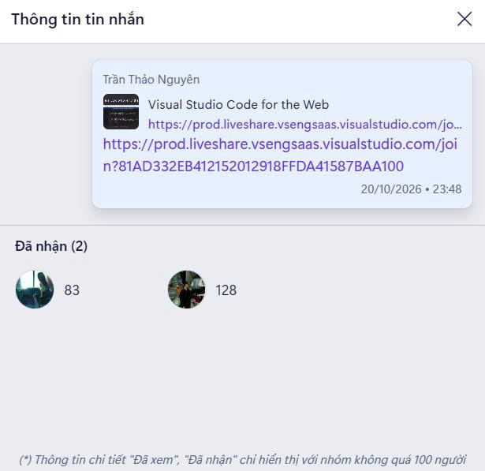
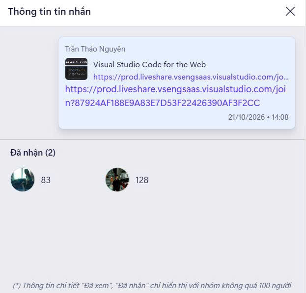
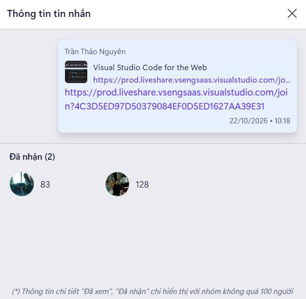

# Báo cáo công việc cá nhân – Huỳnh Thị Mỹ Tuyền

**Môn học:** Công nghệ phần mềm (CNPM)  
**Dự án:** Hệ thống thuyết minh tự động đa ngôn ngữ theo vị trí GPS (Vị Giác)  
**Nhóm:** 04  
**Thành viên:** Huỳnh Thị Mỹ Tuyền  
**Tài khoản GitHub:** [`mytuyen83`](https://github.com/mytuyen83)  
**Repository nhóm:** [CNPM_Nhom4_DCT124C6](https://github.com/nyn06/CNPM_Nhom4_DCT124C6)  
**Giai đoạn ghi nhận:** 19/10–19/11/2026

## 1. Mục đích và cách ghi nhận công việc

Tài liệu ghi lại các công việc tôi trực tiếp tham gia trong quá trình phát triển dự án, chủ yếu ở giao diện du khách, chuyển đổi ngôn ngữ, nội dung thuyết minh, quy trình mua vé và một số chức năng quản trị.

Trong các ngày **19–22/10/2026**, tôi làm việc cùng nhóm qua **Visual Studio Code Live Share**. Nhóm trưởng chia sẻ môi trường lập trình và sử dụng tài khoản `nyn06` để commit các thay đổi chung. Ảnh tin nhắn ở mục 4 xác nhận các buổi chia sẻ; nội dung công việc cá nhân được ghi theo phần việc tôi thực hiện, không nhận toàn bộ nội dung commit của nhóm trưởng là đóng góp riêng.

Với các đợt làm việc sau đó, báo cáo dẫn trực tiếp tới các **commit mang tác giả `mytuyen83`** và các nhánh trên repository nhóm để có thể kiểm tra mã nguồn.

## 2. Công việc thực hiện theo thời gian

### 2.1. Ngày 19–22/10/2026 – Giao diện du khách qua Live Share

Tôi tham gia sửa và kiểm tra phần website dành cho du khách cùng các thành viên trong phiên Live Share, tập trung vào:

- Rà soát các nhãn giao diện, nút, trạng thái và thông báo chưa chuyển đổi đúng giữa tiếng Việt, tiếng Anh, tiếng Nhật và tiếng Hàn.
- Kiểm tra cách cập nhật nội dung trên trang khi người dùng đổi ngôn ngữ; điều chỉnh những phần hiển thị chưa đồng bộ.
- Chỉnh sửa và kiểm tra một số nội dung thuộc **khu vực tìm kiếm địa điểm (POI)** phía du khách, bao gồm nhãn, bộ lọc/trạng thái hiển thị có liên quan.
- Kiểm tra lại các thao tác trên trang sau khi sửa để hạn chế ảnh hưởng đến trải nghiệm đang sử dụng.

**Minh chứng tham gia:** bốn ảnh tin nhắn chứa liên kết Live Share ngày 19, 20, 21 và 22/10 ở mục 4. Các commit của nhóm trong giai đoạn này do tài khoản `nyn06` thực hiện.

### 2.2. Ngày 11/11/2026 – Cập nhật giao diện đa ngôn ngữ, POI và mua vé

Tôi tập hợp các chỉnh sửa đã tham gia thực hiện và đưa lên nhánh [`feature/be-demo-updates`](https://github.com/nyn06/CNPM_Nhom4_DCT124C6/tree/feature/be-demo-updates).

Các công việc bao gồm:

- Sửa việc chuyển đổi giữa bốn ngôn ngữ để nội dung giao diện và thuyết minh cập nhật mà không cần làm mới trang bằng F5.
- Kiểm tra việc đổi ngôn ngữ của nội dung thuyết minh và audio; tránh tự động phát lại audio ngoài ý muốn khi đổi ngôn ngữ.
- Điều chỉnh hiển thị trạng thái **“Chờ vị trí”**, đồng thời kiểm tra việc giữ trạng thái GPS, POI và thông tin truy cập bằng QR khi đổi ngôn ngữ.
- Cập nhật chức năng xử lý bản dịch và thông tin POI; bổ sung các công cụ rà soát bản dịch, chất lượng mô tả và kiểm thử liên quan.
- Phối hợp cập nhật quy trình mua vé: chọn thời lượng/gói, thanh toán mô phỏng và khởi động phiên tham quan.

**Minh chứng Git:** [`7252116` – feat: add POI translation and purchase updates](https://github.com/nyn06/CNPM_Nhom4_DCT124C6/commit/7252116), tác giả `mytuyen83`, ngày 11/11/2026. Commit này có thay đổi tại `public/js/app.js`, `public/js/map.js`, `public/js/translations.js`, `public/js/access.js`, `public/index.html`, các module xử lý mua vé/dịch POI và bài kiểm thử.

### 2.3. Ngày 14/11/2026 – Sửa luồng thanh toán và chuyển ngôn ngữ

Tôi tiếp tục sửa quy trình mua vé trên website du khách và khả năng thay đổi ngôn ngữ trong các bước thao tác:

- Điều chỉnh giao diện và trình tự xử lý của luồng thanh toán/mua vé.
- Sửa các nội dung hiển thị liên quan đến chuyển đổi ngôn ngữ trong giao diện mua vé.
- Đồng bộ các thay đổi ở HTML, CSS và JavaScript của phần khách hàng.

**Nhánh:** [`feature/payment-flow`](https://github.com/nyn06/CNPM_Nhom4_DCT124C6/tree/feature/payment-flow).  
**Commit:** [`3fc7aea` – Fix payment flow and language switching](https://github.com/nyn06/CNPM_Nhom4_DCT124C6/commit/3fc7aea) (tác giả `mytuyen83`).  
**File thay đổi được xác minh:** `public/css/style.css`, `public/index.html`, `public/js/access.js`, `public/js/translations.js`.

### 2.4. Ngày 17/11/2026 – Thống nhất thời lượng tham quan

Tôi sửa để các lựa chọn thời lượng tham quan được thống nhất thành **15, 30 và 60 phút** trên những thành phần liên quan:

- Cập nhật lựa chọn thời lượng ở giao diện khách hàng và quản lý voucher của Admin.
- Điều chỉnh các quy tắc xác thực thời lượng trong service và migration cơ sở dữ liệu.
- Cập nhật bản dịch cho các lựa chọn thời lượng và điều chỉnh bài kiểm thử để kiểm tra cả giá trị hợp lệ lẫn không hợp lệ.

**Nhánh:** [`fix/unify-tour-duration`](https://github.com/nyn06/CNPM_Nhom4_DCT124C6/tree/fix/unify-tour-duration).  
**Commit:** [`67ada96` – fix: unify tour access durations to 15 30 60 minutes](https://github.com/nyn06/CNPM_Nhom4_DCT124C6/commit/67ada96) (tác giả `mytuyen83`).  
**File tiêu biểu:** `public/js/access.js`, `public/admin.html`, `public/js/admin-translations.js`, `src/services/sql/access.service.js`, `src/services/voucher-management.service.js`, `database/migrations/001_initial.sql`, `database/migrations/007_voucher_purchases.sql` và các file test liên quan.

### 2.5. Ngày 18/11/2026 – Sửa trạng thái Dashboard khi làm mới thất bại

Tôi sửa trang Dashboard quản trị để cải thiện khả năng hiển thị trong tình huống API lỗi:

- Giữ các số liệu của lần tải thành công gần nhất thay vì xóa toàn bộ thống kê khi tải lại thất bại.
- Giữ thông báo lỗi đúng trạng thái khi thay đổi ngôn ngữ, không thay bằng thông báo cập nhật thành công gây hiểu nhầm.
- Bổ sung và điều chỉnh các nội dung dịch thuật tương ứng.

**Nhánh:** [`fix/dashboard-refresh-error`](https://github.com/nyn06/CNPM_Nhom4_DCT124C6/tree/fix/dashboard-refresh-error).  
**Commit:** [`bae399c` – fix: preserve dashboard data and error state on refresh failure](https://github.com/nyn06/CNPM_Nhom4_DCT124C6/commit/bae399c) (tác giả `mytuyen83`).  
**File thay đổi được xác minh:** `public/js/admin-dashboard.js`, `public/js/admin-translations.js`.

### 2.6. Ngày 18–19/11/2026 – Cải thiện phản hồi trong quản lý QR và tài khoản Admin

Tôi tiếp tục thực hiện và kiểm thử các thay đổi ở hai trang quản trị:

- Giữ danh sách và thống kê QR gần nhất khi API tải lại thất bại; hiển thị thông báo lỗi thay vì xóa dữ liệu đang có.
- Khi sao chép URL hoặc mã kích hoạt thất bại, tự chọn nội dung trong ô để Admin có thể dùng `Ctrl+C`.
- Duy trì đúng thông báo QR đang hiển thị khi chuyển giữa bốn ngôn ngữ.
- Thêm hộp thoại xác nhận trước khi thay đổi vai trò, khóa hoặc mở khóa tài khoản Admin.
- Rà soát và bổ sung bản dịch tiếng Việt, Anh, Nhật, Hàn cho nhãn và thông báo của hai trang; cập nhật các bài kiểm thử giao diện.

**Nhánh:** [`fix/admin-qr-account-feedback-i18n`](https://github.com/nyn06/CNPM_Nhom4_DCT124C6/tree/fix/admin-qr-account-feedback-i18n). Nhánh này xuất hiện trong danh sách **Your branches** trên GitHub của tài khoản tôi, theo ảnh chụp ngày 19/11/2026; chưa gán mã commit cụ thể vì chưa đối chiếu được lịch sử commit của nhánh này.

**Các file thuộc phạm vi chỉnh sửa:** `public/js/admin-vouchers.js`, `public/js/accounts.js`, `public/js/admin-translations.js`, `public/admin.html`, `tests/frontend.admin.vouchers.test.js`, `tests/frontend.auth.test.js`.

**Kết quả kiểm thử trên máy:** 36/36 test suites và 892/892 test cases đạt; `npm run lint` có 0 lỗi và 1 cảnh báo cũ; `git diff --check` không báo lỗi. Đây là kết quả kiểm thử cục bộ, **không tự đồng nghĩa với việc nhánh đã được merge vào `main`**.

## 3. Tổng hợp năm nhánh và liên kết GitHub

Các nhánh dưới đây được ghi nhận trong phần **Your branches** của repository trên ảnh GitHub ngày 19/11/2026. Bốn nhánh đầu có commit mang tên tác giả `mytuyen83` đã đối chiếu được từ Git; nhánh thứ năm được xác nhận tồn tại qua ảnh danh sách nhánh và lịch sử làm việc, nhưng chưa gắn mã commit chưa xác minh.

| Nhánh | Nội dung chính | Minh chứng commit |
|---|---|---|
| [`feature/be-demo-updates`](https://github.com/nyn06/CNPM_Nhom4_DCT124C6/tree/feature/be-demo-updates) | Bản dịch POI, chuyển ngôn ngữ, cập nhật mua vé; tập hợp công việc Live Share 04/11 | [`7252116`](https://github.com/nyn06/CNPM_Nhom4_DCT124C6/commit/7252116) |
| [`feature/payment-flow`](https://github.com/nyn06/CNPM_Nhom4_DCT124C6/tree/feature/payment-flow) | Luồng thanh toán và chuyển ngôn ngữ | [`3fc7aea`](https://github.com/nyn06/CNPM_Nhom4_DCT124C6/commit/3fc7aea) |
| [`fix/unify-tour-duration`](https://github.com/nyn06/CNPM_Nhom4_DCT124C6/tree/fix/unify-tour-duration) | Thời lượng 15–30–60 phút | [`67ada96`](https://github.com/nyn06/CNPM_Nhom4_DCT124C6/commit/67ada96) |
| [`fix/dashboard-refresh-error`](https://github.com/nyn06/CNPM_Nhom4_DCT124C6/tree/fix/dashboard-refresh-error) | Giữ dữ liệu và thông báo lỗi Dashboard | [`bae399c`](https://github.com/nyn06/CNPM_Nhom4_DCT124C6/commit/bae399c) |
| [`fix/admin-qr-account-feedback-i18n`](https://github.com/nyn06/CNPM_Nhom4_DCT124C6/tree/fix/admin-qr-account-feedback-i18n) | Thông báo QR, xác nhận quản lý tài khoản và đa ngôn ngữ | [Xem lịch sử nhánh](https://github.com/nyn06/CNPM_Nhom4_DCT124C6/commits/fix/admin-qr-account-feedback-i18n) |

Các commit được liên kết trực tiếp tới trang thay đổi mã nguồn; trạng thái nhánh có thể tiếp tục thay đổi khi nhóm trưởng merge hoặc cập nhật repository.

## 4. Hình ảnh minh chứng Live Share ngày 19–22/10/2026

Các ảnh này do nhóm trưởng đưa vào thư mục `docs/images/` trong repository, theo nhật ký phát triển do nhóm trưởng cung cấp. File Markdown phải nằm ở **thư mục gốc repository**, cùng cấp với `README.md`, để các đường dẫn tương đối sau hoạt động. Không cần đưa thêm ảnh vào commit nếu chúng đã có trên nhánh đích.

*Hình 1. Tin nhắn Zalo chia sẻ phiên Live Share ngày 19/10/2026.*

*Hình 2. Tin nhắn Zalo chia sẻ phiên Live Share ngày 20/10/2026.*

*Hình 3. Tin nhắn Zalo chia sẻ phiên Live Share ngày 21/10/2026.*

*Hình 4. Tin nhắn Zalo chia sẻ phiên Live Share ngày 22/10/2026.*

## 5. Nguồn đối chiếu và ghi chú

- [Repository dự án](https://github.com/nyn06/CNPM_Nhom4_DCT124C6), [danh sách nhánh](https://github.com/nyn06/CNPM_Nhom4_DCT124C6/branches) và [các commit của tài khoản `mytuyen83`](https://github.com/nyn06/CNPM_Nhom4_DCT124C6/commits?author=mytuyen83).
- Bốn commit đã đối chiếu trực tiếp qua dữ liệu lịch sử Git: `7252116`, `3fc7aea`, `67ada96`, `bae399c`.
- Danh sách trên GitHub ghi nhận năm nhánh nêu tại mục 3; ảnh tin nhắn Zalo 19–22/10 xác nhận việc chia sẻ phiên Live Share.
- Nhật ký của nhóm trưởng (`nyn06`) cung cấp bối cảnh lịch sử commit chung; đóng góp cá nhân trong Live Share không được suy ra từ toàn bộ file của commit nhóm trưởng.
- Thời điểm làm việc thực tế có thể trước ngày commit, điển hình là phiên Live Share 04/11 được tổng hợp vào đợt cập nhật và commit 11/11.

## 6. Kết luận

Tôi đã tham gia phát triển và hoàn thiện những phần quan trọng về giao diện du khách và trải nghiệm đa ngôn ngữ, tìm kiếm địa điểm, thuyết minh/audio, mua vé và thời lượng tham quan; đồng thời sửa các tình huống phản hồi lỗi ở Dashboard, quản lý QR và tài khoản Admin. Báo cáo kết hợp ghi chép công việc cá nhân, minh chứng Live Share và liên kết GitHub để thuận tiện kiểm tra, đồng thời phân biệt rõ các thay đổi chung của nhóm với các commit được ghi nhận bằng tài khoản `mytuyen83`.
